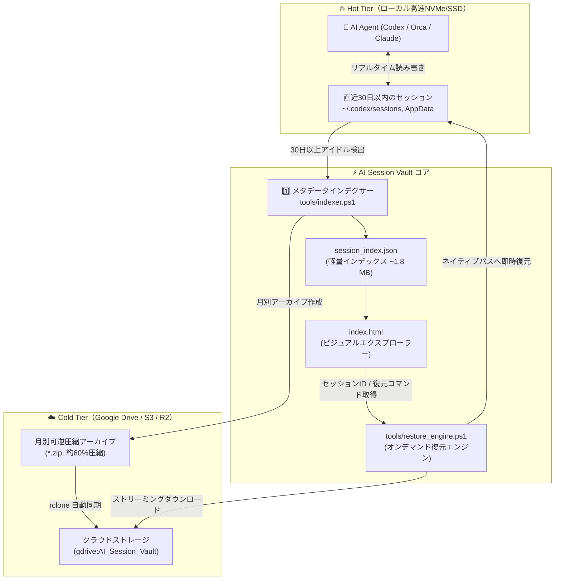

# 🚀 AI Session Universal Vault & Lifecycle Manager

<p align="center">
  <a href="README.md">English</a> | <a href="README.ko.md">한국어</a> | <b>日本語</b>
</p>

<p align="center">
  <a href="LICENSE"></a>
  
  
</p>

> **自律型AIエージェントのセッション向け 超軽量階層化ストレージ＆完全復元ライフサイクルマネージャー**  
> 過去の会話コンテキスト、プロンプト、復元ポイントを損なうことなく、ローカルSSDの容量を劇的に解放します。

---

## ⚡ 課題：AIエージェントのログ肥大化によるSSD容量枯渇

**OpenAI Codex CLI, Orca, Claude Code, Cline, Cursor, Antigravity** などの自律型AIエージェントは、日々の開発タスクに伴い膨大なセッションログを蓄積します：
* プロンプトと会話ターンの全履歴
* サブエージェントの呼び出しとツール実行結果
* ターミナル出力およびASTコード差分（Diff）
* 思考プロセス（Chain-of-Thought）ログ（`rollout-*.jsonl`）

AIエージェントを日常的に活用している開発者の場合、**わずか2〜3ヶ月で100 GB〜200 GB以上もの高速SSD容量が消費**されてしまいます。

これを単純に一括削除するとディスク容量は回復しますが、**過去の作業コンテキスト、問題解決の意思決定ログ、そして過去セッションの再開（Resume）機能が永久に失われてしまいます**。

---

## 💡 解決策：AI Session Universal Vault

**AI Session Vault** は、エンタープライズレベルの **階層化ストレージ（Hot vs. Cold Tier）** アーキテクチャと **即時ビジュアルエクスプローラー** を提供し、このトレードオフを完全に解決します：

1. **🔥 Hot Tier（ローカル高速SSD）**: 直近30日以内のアクティブセッションは、ネイティブパス上にそのまま維持され、遅延ゼロで読み書き可能です。
2. **☁️ Cold Tier（クラウドストレージ）**: 30日以上経過したセッションは月別ZIPアーカイブに可逆圧縮され、Google Drive、AWS S3、Cloudflare R2、OneDrive などに自動同期されます。
3. **⚡ 99.9%の容量削減**: クラウド同期後は大容量アーカイブをローカルから安全に破棄可能。超軽量メタデータインデックス（**3,600セッションで約1.8 MB**）のみをローカルに保持します。
4. **🖥️ 依存関係ゼロのビジュアル検索（`index.html`）**: Node.jsやPython、データベースの立ち上げは一切不要。ブラウザをダブルクリックするだけで、50ms以内に数千のセッションをインメモリ高速検索できます。
5. **🔄 透過的なオンデマンドストリーミング復元**: 過去のセッションが必要になった場合、アーカイブ全体を手動で再ダウンロードする必要はありません。復元スクリプトがクラウドから該当ファイルのみをバックグラウンド取得し、元のエージェントパスに即座に展開します。

---

## 🏗️ システムアーキテクチャ



---

## 📁 ディレクトリ構成

```text
ai-session-vault/
├── index.html                  # スタンドアロンビジュアル検索UI（ブラウザ実行）
├── 1_Search_Sessions.bat       # セッション検索ランチャー
├── 2_Restore_Session.bat       # インタラクティブ復元CLIランチャー
├── 3_Archive_Old_Sessions.bat  # 30日経過セッションの圧縮＆クラウド同期
├── 4_Clear_Local_Sessions.bat  # クラウド退避済みローカルセッションの削除
├── config.example.json         # 設定テンプレート（エージェントパス、保存日数、リモート設定）
├── session_index.sample.json   # デモプレビュー用匿名サンプルデータ
├── LICENSE                     # MIT License
├── README.md                   # English Documentation
├── README.ko.md                # 韓国語ドキュメント
├── README.ja.md                # 日本語ドキュメント
└── tools/
    ├── indexer.ps1             # エージェントディレクトリ走査＆インデックス生成
    ├── archive_engine.ps1      # アイドルセッション圧縮＆クラウドアップロード
    ├── restore_engine.ps1      # クラウドからのストリーミング復元
    └── clear_engine.ps1        # ローカルディスク容量解放
```

---

## 🚀 クイックスタート (Quick Start)

### 1. クローンと初期設定
```bash
git clone https://github.com/wsh096/ai-session-vault.git
cd ai-session-vault
cp config.example.json config.json
```

### 2. セッション検索UIの起動
`1_Search_Sessions.bat` をダブルクリックするか、ブラウザで `index.html` を開きます。  
ローカルインデックス未生成時は、**サンプルデモモード**（`session_index.sample.json`）で即座に動作確認できます。

### 3. ローカルエージェントセッションのインデックス作成
ローカルのAIエージェントフォルダをスキャンし、実際の `session_index.json` を構築します：
```powershell
powershell -ExecutionPolicy Bypass -File tools/indexer.ps1
```

### 4. 30日経過セッションのアーカイブとクラウド転送
設定した保持期間（デフォルト30日）を超えたセッションを圧縮し、クラウドへ転送します：
```powershell
powershell -ExecutionPolicy Bypass -File tools/archive_engine.ps1 -UploadToCloud
```

### 5. 必要な過去セッションをオンデマンド復元
`2_Restore_Session.bat` を実行するか、CLIから直接コマンドを実行します：
```powershell
# セッションIDを指定して単一セッションを復元
powershell -ExecutionPolicy Bypass -File tools/restore_engine.ps1 -SessionId "<セッションID>"

# または月別アーカイブ全体を一括復元
powershell -ExecutionPolicy Bypass -File tools/restore_engine.ps1 -ArchiveName "Codex_2026_07.zip"
```
*ローカルSSDにZIPファイルが存在しない場合でも、クラウドから該当ファイルのみをバックグラウンド取得して自動復元します。*

### 6. ローカルSSD容量の解放
クラウドへのアップロード完了後、`4_Clear_Local_Sessions.bat` を実行してローカルの過去ログを消去します。直近30日のアクティブセッションは保護されます。

---

## ⚙️ 設定ファイル仕様 (`config.json`)

```json
{
  "vaultName": "AI_Session_Vault",
  "idleDaysThreshold": 30,
  "cloudRemote": "gdrive:AI_Session_Vault",
  "compression": {
    "format": "zip",
    "grouping": "monthly"
  },
  "agentTargets": [
    {
      "name": "Codex",
      "path": "%USERPROFILE%/.codex/sessions",
      "sessionPattern": "rollout-*.jsonl",
      "enabled": true
    },
    {
      "name": "Orca",
      "path": "%APPDATA%/orca/codex-runtime-home/home/sessions",
      "sessionPattern": "rollout-*.jsonl",
      "enabled": true
    },
    {
      "name": "ClaudeCode",
      "path": "%USERPROFILE%/.claude/sessions",
      "sessionPattern": "*.jsonl",
      "enabled": false
    }
  ]
}
```

---

## ☁️ クラウドストレージの接続 (rclone)

AI Session Vault は、特定ベンダーに縛られないマルチクラウド運用のために [rclone](https://rclone.org/) を採用しています：

1. rclone のインストール：
   ```powershell
   winget install Rclone.Rclone
   ```
2. クラウド接続の設定（Google Drive、AWS S3、OneDrive 等）：
   ```bash
   rclone config
   ```
3. `config.json` の `"cloudRemote"` にリモート名を指定します（例: `"gdrive:AI_Session_Vault"`）。

---

## 🔒 プライバシーとセキュリティ

* **テレメトリ一切なし（Zero Telemetry）**: 外部の分析サーバーやサードパーティへのデータ送信は一切行いません。
* **完全な自己保有（100% User Owned）**: すべてのデータはお使いのローカルマシンと個人クラウドのみで管理されます。
* **機密情報の徹底除外**: `.gitignore` により、実セッションファイル、認証トークン、圧縮ファイルがGitHubへ誤ってコミットされることを防ぎます。

---

## 🤝 コントリビューション (Contributing)

バグ報告、機能提案、プルリクエストを心よりお待ちしております！  
気になる点や追加機能のアイデアは [GitHub Issues](https://github.com/wsh096/ai-session-vault/issues) にてお気軽にお知らせください。

---

## 📄 ライセンス (License)

本プロジェクトは [MIT License](LICENSE) のもとで公開されています。
