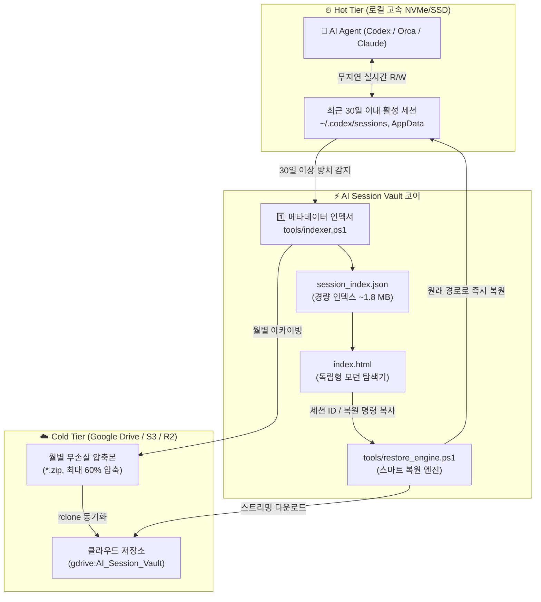

# 🚀 AI Session Universal Vault & Lifecycle Manager

<p align="center">
  <a href="README.md">English</a> | <b>한국어</b> | <a href="README.ja.md">日本語</a>
</p>

<p align="center">
  <a href="LICENSE"></a>
  
  
</p>

> **자율형 AI 에이전트 세션을 위한 초경량 계층화 스토리지 & 무손실 라이프사이클 매니저**  
> 과거의 대화 맥락, 프롬프트, 복원 포인트를 영구 보존하면서 로컬 고속 SSD 공간을 획기적으로 확보하세요.

---

## ⚡ 문제 정의: AI 에이전트 세션의 폭발적 용량 증가

**OpenAI Codex CLI, Orca, Claude Code, Cline, Cursor, Antigravity**와 같은 자율형 AI 개발 도구는 다음과 같은 방대한 실행 이력을 모두 로컬 디스크에 기록합니다:
* 프롬프트 입력 및 대화 턴(Turn)
* 서브에이전트 호출 및 도구 실행 결과
* 터미널 쉘 출력 및 AST 코드 Diff
* 심층 추론 및 사고 과정(Chain-of-Thought) 로그 (`rollout-*.jsonl`)

에이전트를 활발히 사용하는 개발자의 경우, **불과 2~3개월 만에 100 GB ~ 200 GB 이상의 고속 SSD 용량이 잠식**됩니다.

이를 무작정 삭제하면 디스크 공간은 생기지만, **과거 작업 맥락, 문제 해결 히스토리, 이전 세션 재개(Resume) 기능이 영구적으로 손실**됩니다.

---

## 💡 해결책: AI Session Universal Vault

**AI Session Vault**는 엔터프라이즈급 **계층화 스토리지 (Hot vs. Cold Tier)** 기술과 **즉각형 시각 검색기**를 결합하여 이 문제를 해결합니다:

1. **🔥 Hot Tier (로컬 SSD)**: 최근 30일 이내의 활성 세션은 로컬 고속 스토리지에 무지연 실시간으로 그대로 유지됩니다.
2. **☁️ Cold Tier (클라우드 스토리지)**: 30일 이상 미사용 세션은 월별 무손실 ZIP 아카이브로 자동 압축되어 Google Drive, AWS S3, Cloudflare R2, OneDrive 등에 동기화됩니다.
3. **⚡ 99.9% 스토리지 회수**: 클라우드 업로드 후 무거운 로컬 압축본을 비워도 초경량 메타데이터 인덱스(**3,600개 세션 기준 단 ~1.8 MB**)만 남겨 디스크를 즉시 회수합니다.
4. **🖥️ Zero-Dependency 시각 탐색기 (`index.html`)**: Node.js, Python, DB 설치 없이 브라우저 더블 클릭만으로 0.05초 만에 수천 개의 세션을 실시간 검색합니다.
5. **🔄 투명한 온디맨드 스트리밍 복원**: 과거 세션이 다시 필요할 때 전체를 다운받을 필요 없이, 클라우드에서 해당 아카이브만 백그라운드로 스트리밍 다운로드하여 원래 에이전트 경로로 즉시 주입 복원합니다.

---

## 🏗️ 시스템 아키텍처



---

## 📁 저장소 디렉터리 구조

```text
ai-session-vault/
├── index.html                  # 독립형 시각 탐색기 (브라우저에서 더블 클릭 실행)
├── 1_Search_Sessions.bat       # 검색기 즉시 실행 런처
├── 2_Restore_Session.bat       # 대화형 세션 복원 CLI 런처
├── 3_Archive_Old_Sessions.bat  # 30일 경과 세션 자동 압축 및 클라우드 업로드
├── 4_Clear_Local_Sessions.bat  # 백업 완료된 로컬 구세션 삭제 (SSD 용량 회수)
├── config.example.json         # 환경 설정 템플릿 (에이전트 경로, 방치일, 클라우드 설정)
├── session_index.sample.json   # 데모 체험용 익명화 샘플 데이터셋
├── LICENSE                     # MIT 라이선스
├── README.md                   # English Documentation
├── README.ko.md                # 한국어 문서
├── README.ja.md                # 日本語ドキュメント
└── tools/
    ├── indexer.ps1             # 에이전트 경로 스캔 및 메타데이터 인덱스 추출
    ├── archive_engine.ps1      # 방치 세션 압축 및 클라우드 동기화
    ├── restore_engine.ps1      # 클라우드 스트리밍 다운로드 및 세션 복원
    └── clear_engine.ps1        # 안전한 로컬 세션 정리
```

---

## 🚀 빠른 시작 가이드 (Quick Start)

### 1. 저장소 복제 및 설정
```bash
git clone https://github.com/wsh096/ai-session-vault.git
cd ai-session-vault
cp config.example.json config.json
```

### 2. 세션 검색기 실행
`1_Search_Sessions.bat`를 더블 클릭하거나 브라우저에서 `index.html`을 엽니다.  
로컬 인덱스를 생성하기 전에는 **샘플 데모 모드**(`session_index.sample.json`)로 작동하여 기능을 즉시 테스트해볼 수 있습니다.

### 3. 로컬 에이전트 세션 인덱싱
로컬 PC의 AI 에이전트 디렉터리를 스캔하여 실제 `session_index.json`을 생성합니다:
```powershell
powershell -ExecutionPolicy Bypass -File tools/indexer.ps1
```

### 4. 30일 지난 세션 압축 및 클라우드 백업
방치된 세션을 압축하여 지정된 클라우드로 안전하게 백업합니다:
```powershell
powershell -ExecutionPolicy Bypass -File tools/archive_engine.ps1 -UploadToCloud
```

### 5. 필요할 때 세션 즉시 복원
`2_Restore_Session.bat`을 실행하거나 CLI에서 다음 명령을 실행합니다:
```powershell
# 세션 ID로 단일 세션 복원
powershell -ExecutionPolicy Bypass -File tools/restore_engine.ps1 -SessionId "<세션-ID>"

# 또는 특정 월 전체 아카이브 복원
powershell -ExecutionPolicy Bypass -File tools/restore_engine.ps1 -ArchiveName "Codex_2026_07.zip"
```
*로컬 SSD에 압축 파일이 없더라도 클라우드에서 해당 파일만 백그라운드로 자동 다운로드하여 복원합니다.*

### 6. 로컬 디스크 공간 비우기
클라우드 업로드가 완료된 후 `4_Clear_Local_Sessions.bat`를 실행하여 로컬 디스크를 차지하는 과거 로그를 비웁니다.  
최근 30일 이내의 활성 세션은 안전하게 유지됩니다.

---

## ⚙️ 설정 파일 가이드 (`config.json`)

```json
{
  "vaultName": "AI_Session_Vault",
  "idleDaysThreshold": 30,
  "cloudRemote": "gdrive:AI_Session_Vault",
  "compression": {
    "format": "zip",
    "grouping": "monthly"
  },
  "agentTargets": [
    {
      "name": "Codex",
      "path": "%USERPROFILE%/.codex/sessions",
      "sessionPattern": "rollout-*.jsonl",
      "enabled": true
    },
    {
      "name": "Orca",
      "path": "%APPDATA%/orca/codex-runtime-home/home/sessions",
      "sessionPattern": "rollout-*.jsonl",
      "enabled": true
    },
    {
      "name": "ClaudeCode",
      "path": "%USERPROFILE%/.claude/sessions",
      "sessionPattern": "*.jsonl",
      "enabled": false
    }
  ]
}
```

---

## ☁️ 클라우드 스토리지 연동 (rclone)

AI Session Vault는 특정 클라우드에 종속되지 않도록 [rclone](https://rclone.org/)을 활용합니다:

1. rclone 설치:
   ```powershell
   winget install Rclone.Rclone
   ```
2. 클라우드 연결 설정 (Google Drive, AWS S3, OneDrive 등):
   ```bash
   rclone config
   ```
3. `config.json`의 `"cloudRemote"`에 원격지 이름을 지정합니다 (예: `"gdrive:AI_Session_Vault"`).

---

## 🔒 개인정보 및 보안 최우선

* **외부 전송 제로 (Zero Telemetry)**: 어떠한 데이터도 외부 분석 서버나 서드파티로 전송되지 않습니다.
* **사용자 완전 소유권**: 모든 데이터는 오직 사용자의 로컬 PC와 개인 클라우드 계정에만 저장됩니다.
* **민감 정보 차단**: `.gitignore`가 실제 세션 파일, 인증 토큰, 아카이브를 철저히 차단하여 GitHub에 개인정보가 노출되지 않습니다.

---

## 🤝 기여하기 (Contributing)

버그 리포트, 제안, 풀 리퀘스트를 언제나 환영합니다!  
궁금한 점이나 추가 기능 제안은 [GitHub Issues](https://github.com/wsh096/ai-session-vault/issues)에 남겨주세요.

---

## 📄 라이선스 (License)

이 프로젝트는 [MIT 라이선스](LICENSE)에 따라 자유롭게 사용 및 수정, 배포할 수 있습니다.
