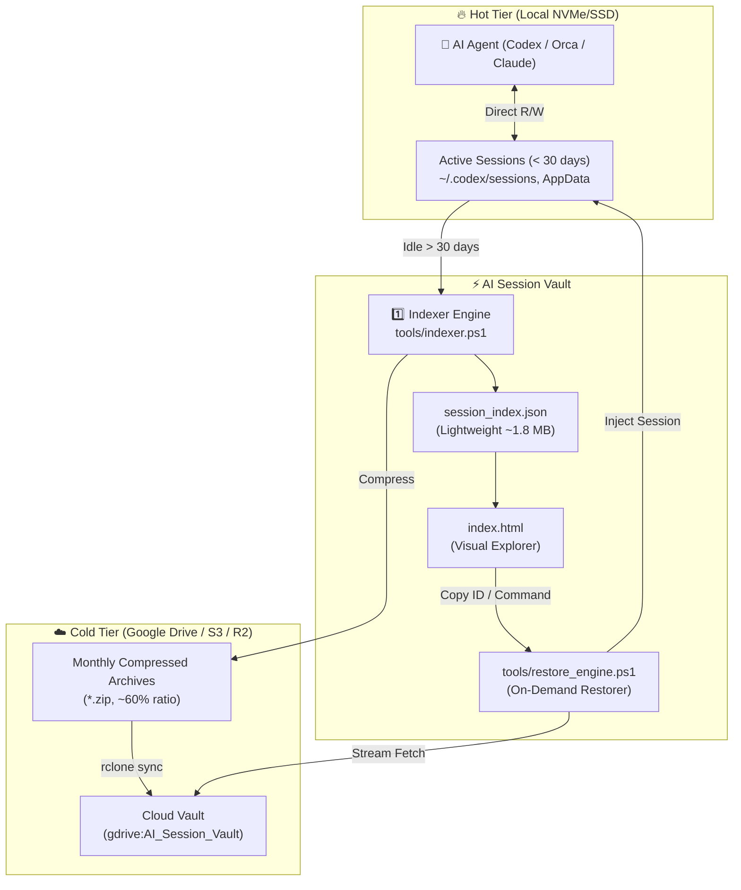

# 🚀 AI Session Universal Vault & Lifecycle Manager

[](LICENSE)
[]()
[]()

> **Ultra-lightweight tiered storage & lossless lifecycle manager for autonomous AI agent sessions.**  
> Keep your local NVMe/SSD lean without ever losing past context, prompts, or conversation restore points.

---

## ⚡ The Problem: AI Agent Session Bloat

Autonomous agentic developer tools (such as **OpenAI Codex CLI, Orca, Claude Code, Cline, Cursor, and Antigravity**) record complete execution traces:
* Prompt interactions & conversational turns
* Tool invocations & subagent outputs
* Terminal shell dumps and AST diffs
* Reasoning and Chain-of-Thought logs (`rollout-*.jsonl`)

In an active developer workflow, **3 months of agent usage can easily consume 100 GB ~ 200 GB+ of high-speed SSD storage**. 

Deleting them blindly solves the disk space issue but destroys past context, audit logs, and the ability to resume historical sessions.

---

## 💡 The Solution: AI Session Universal Vault

**AI Session Vault** provides enterprise-grade **Tiered Storage (Hot vs. Cold)** and an **instant visual explorer** for your AI sessions:

1. **🔥 Hot Tier (Local SSD)**: Active sessions from the last 30 days remain untouched in their native agent directories with zero latency.
2. **☁️ Cold Tier (Cloud Storage)**: Sessions older than 30 days are automatically losslessly compressed by month into `.zip` archives and synced to Google Drive, AWS S3, Cloudflare R2, or OneDrive.
3. **⚡ 99.9% Storage Reclaim**: Once uploaded, heavy local archives can be purged from local SSD. Only an ultra-lightweight metadata index (**~1.8 MB** for 3,600+ sessions) remains.
4. **🖥️ Zero-Dependency Visual Search WebApp (`index.html`)**: Open in any browser without installing Node.js, Python, or database servers. Search through thousands of sessions in under 50ms.
5. **🔄 Transparent On-Demand Streaming Restore**: When you need an old session, the restore engine transparently downloads only the needed archive from the cloud and restores the session file directly into your agent's directory in seconds.

---

## 🏗️ Architecture



---

## 📁 Repository Structure

```text
ai-session-vault/
├── index.html                  # Standalone Visual Explorer (Double-click to open)
├── 1_Search_Sessions.bat       # Launcher for Search UI
├── 2_Restore_Session.bat       # Launcher for Restore CLI
├── 3_Archive_Old_Sessions.bat  # Automated compression & cloud backup
├── 4_Clear_Local_Sessions.bat  # Purge old local sessions to reclaim SSD space
├── config.example.json         # Configuration template (Paths, idle days, cloud remote)
├── session_index.sample.json   # Anonymized sample dataset for instant preview
├── LICENSE                     # MIT License
└── tools/
    ├── indexer.ps1             # Scans agent directories & extracts metadata
    ├── archive_engine.ps1      # Compresses idle sessions & uploads to cloud
    ├── restore_engine.ps1      # Auto-fetches from cloud & extracts session
    └── clear_engine.ps1        # Safely evicts local logs older than threshold
```

---

## 🚀 Quick Start

### 1. Clone & Configure
```bash
git clone https://github.com/wsh096/ai-session-vault.git
cd ai-session-vault
cp config.example.json config.json
```

### 2. Search Existing Sessions
Double-click `1_Search_Sessions.bat` or open `index.html` in your web browser.  
If no local index is built yet, it runs in **Sample Demo Mode** using `session_index.sample.json`.

### 3. Build Your Local Index
Scan your local AI agent directories and generate your real `session_index.json`:
```powershell
powershell -ExecutionPolicy Bypass -File tools/indexer.ps1
```

### 4. Archive & Sync to Cloud
Archive sessions older than 30 days and sync them to your cloud:
```powershell
powershell -ExecutionPolicy Bypass -File tools/archive_engine.ps1 -UploadToCloud
```

### 5. Restore Past Sessions on Demand
Double-click `2_Restore_Session.bat` or run:
```powershell
# Restore by Session ID
powershell -ExecutionPolicy Bypass -File tools/restore_engine.ps1 -SessionId "<session-id>"

# Or restore an entire month
powershell -ExecutionPolicy Bypass -File tools/restore_engine.ps1 -ArchiveName "Codex_2026_07.zip"
```
*If the archive is not on your local SSD, it is automatically downloaded from your cloud remote transparently.*

### 6. Free Up Local SSD Space
Once your archives are safely in the cloud, run `4_Clear_Local_Sessions.bat` to purge old local raw files.  
Your active sessions within the last 30 days are strictly preserved.

---

## ⚙️ Configuration (`config.json`)

```json
{
  "vaultName": "AI_Session_Vault",
  "idleDaysThreshold": 30,
  "cloudRemote": "gdrive:AI_Session_Vault",
  "compression": {
    "format": "zip",
    "grouping": "monthly"
  },
  "agentTargets": [
    {
      "name": "Codex",
      "path": "%USERPROFILE%/.codex/sessions",
      "sessionPattern": "rollout-*.jsonl",
      "enabled": true
    },
    {
      "name": "Orca",
      "path": "%APPDATA%/orca/codex-runtime-home/home/sessions",
      "sessionPattern": "rollout-*.jsonl",
      "enabled": true
    },
    {
      "name": "ClaudeCode",
      "path": "%USERPROFILE%/.claude/sessions",
      "sessionPattern": "*.jsonl",
      "enabled": false
    }
  ]
}
```

---

## ☁️ Cloud Storage Setup (rclone)

AI Session Vault uses [rclone](https://rclone.org/) to remain cloud-agnostic. To connect your cloud:

1. Install rclone:
   ```powershell
   winget install Rclone.Rclone
   ```
2. Configure your remote (e.g. Google Drive, AWS S3, OneDrive):
   ```bash
   rclone config
   ```
3. Set `"cloudRemote": "your-remote-name:AI_Session_Vault"` in `config.json`.

---

## 🔒 Privacy & Security First

* **Zero Telemetry**: No tracking, no external third-party servers.
* **100% User Owned**: Data stays on your local machine and your private cloud account.
* **Sensitive File Exclusion**: `.gitignore` strictly excludes real session logs, indices, tokens, and archive files by default.

---

## 🤝 Contributing

Contributions, issues, and feature requests are welcome!  
Feel free to check out [issues](https://github.com/wsh096/ai-session-vault/issues).

---

## 📄 License

Distributed under the MIT License. See [LICENSE](LICENSE) for details.
